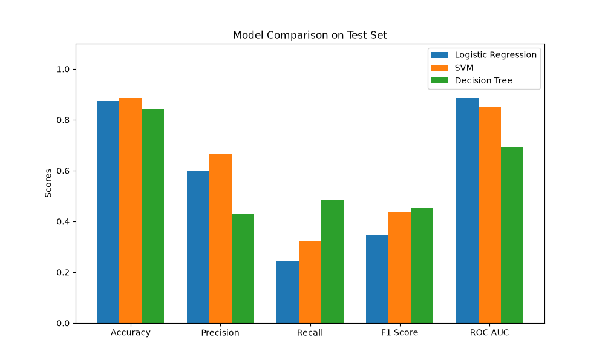
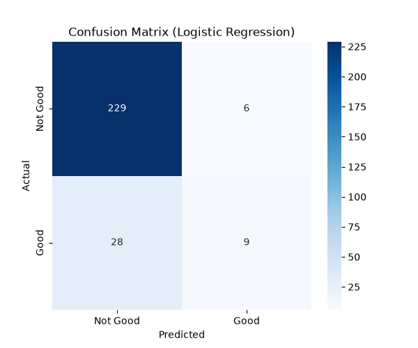
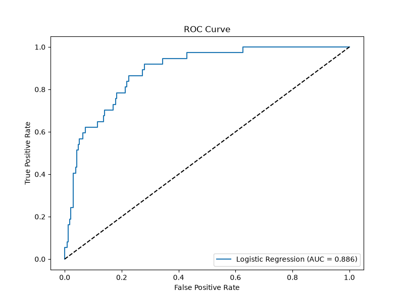
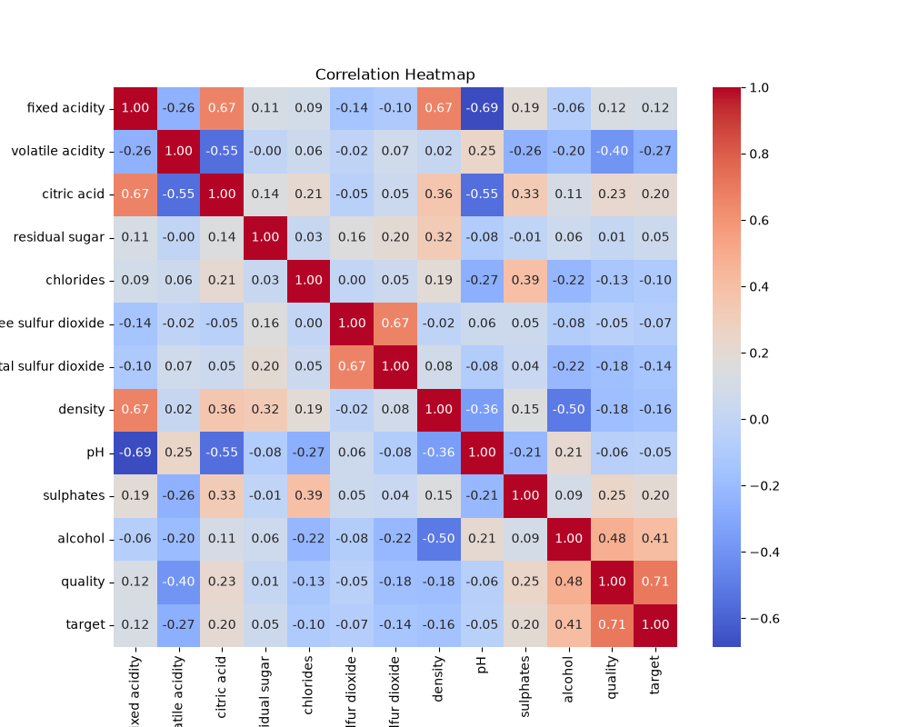
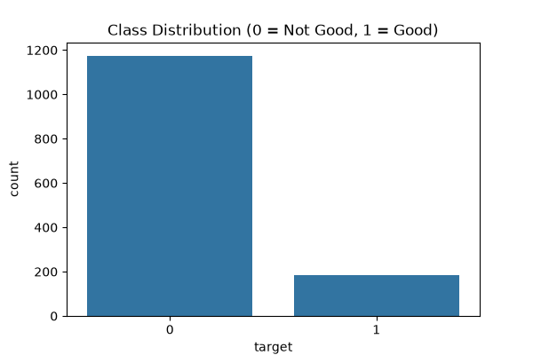

# Wine Quality Predictor 🍷

This repository contains a complete end-to-end Machine Learning pipeline to predict the quality of red wine based on its chemical properties.

## 🔗 Live Application
**Streamlit Web App:** [Click here to view the live app](#) *(Add your Streamlit Cloud link here once deployed)*

---

## 📊 Dataset Information
- **Name:** Wine Quality (Red) Dataset
- **Source:** [UCI Machine Learning Repository](https://wine-quality-predictor-ualor4mfumaww3uv6bfrrc.streamlit.app/)
- **Number of Records:** 1,599 instances
- **Features:** 11 chemical properties (e.g., fixed acidity, pH, alcohol, etc.)
- **Target Variable:** Binary classification predicting if a wine is "good" (Quality score >= 7) or "not good" (Quality score < 7).

---

## 📈 Model Performance
Three models were evaluated (Logistic Regression, Support Vector Machine, and Decision Tree). **Logistic Regression** achieved the best balance and was selected as the final model.

**Test Set Metrics for Logistic Regression:**
- **Accuracy:** 87.50%
- **Precision:** 60.00%
- **Recall:** 24.32%
- **F1 Score:** 34.62%
- **ROC AUC:** 88.60%

---

## 🖼️ Screenshots & Visualizations

### Streamlit Application

*(Make sure you upload a screenshot of your app to `screenshots/app.png`)*

### Model Performance Plots
#### Model Comparison


#### Confusion Matrix


#### ROC Curve


#### Correlation Heatmap


#### Class Distribution


---

## 🚀 How to Run Locally

1. **Clone the repository:**
   ```bash
   git clone https://github.com/your-username/wine-quality-predictor.git
   cd wine-quality-predictor
   ```

2. **Install dependencies:**
   ```bash
   pip install -r requirements.txt
   ```

3. **Run the Streamlit app:**
   ```bash
   streamlit run app.py
   ```

## 📁 Repository Structure
- `app.py`: The Streamlit web application.
- `main.py`: The training pipeline script used to preprocess data, train models, and generate plots.
- `model.pkl`: The trained best model (Logistic Regression).
- `dataset.csv`: The Red Wine Quality dataset.
- `report.pdf`: The detailed final project report.
- `requirements.txt`: Python dependencies required to run the code.
- `plots/`: Data visualization and model evaluation graphs.
- `screenshots/`: Screenshots of the application.
